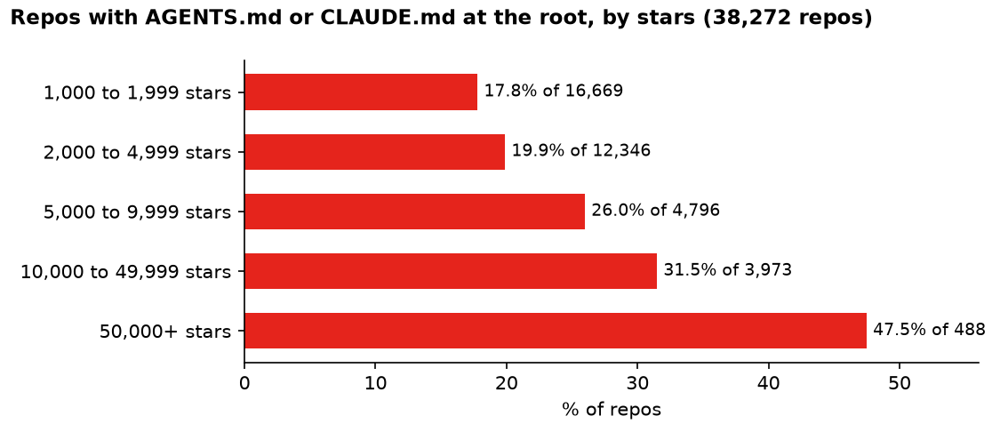

# Agent Files Index

[](https://github.com/prasadus92/agent-files-index/actions/workflows/test.yml) [](data/LICENSE) [](LICENSE)

An open dataset of what public `AGENTS.md`, `CLAUDE.md` and `SKILL.md` files contain, and `agentfiles`, a checker that lints your own files against rules drawn from that data and from the published guidance.

- **Data:** CSV and Parquet in [`data/`](data/), licensed [CC BY 4.0](data/LICENSE). Data card: [`data/README.md`](data/README.md).
- **Checker:** Python 3.10+, no dependencies, MIT licensed.
- **Method:** [`docs/method.md`](docs/method.md). Write-up: [prasad.tech/blog/agent-files-index](https://prasad.tech/blog/agent-files-index/).

## Findings, snapshot 15 November 2026

The frame is 38,272 public repos with 1,000 or more stars (a census) and 7,912 repos with 100 to 999 stars (a 5% sample by creation day, standing for about 158,100 repos). All of them had a push in the last 12 months.

- **Adoption.** 21.3% of the 1,000+ star repos have an `AGENTS.md` or `CLAUDE.md` at the root: 17.3% have `AGENTS.md`, 12.0% `CLAUDE.md`, 8.0% both. In the 100 to 999 star sample it is 15.2%.
- **Stars and age.** Adoption rises from 17.8% at 1,000 to 1,999 stars to 47.5% at 50,000 or more. 38.9% of 1,000+ star repos created in 2026 have one, against 15% to 17% for repos created between 2013 and 2020.
- **Length.** The median `AGENTS.md` is 94 lines and the median `CLAUDE.md` is 58. 17.0% of `CLAUDE.md` files are over the 200 lines Claude Code's docs suggest. 4.1% of `AGENTS.md` files are over the 32 KiB that Codex reads.
- **Commands.** 62.1% of `AGENTS.md` files and 43.4% of `CLAUDE.md` files give the agent a test command.
- **Both files.** In the 3,285 repos with both, `CLAUDE.md` imports `AGENTS.md` in 37.8%, is a symlink to it in 24.2%, mentions it in 16.4%, and never refers to it in 20.7%. Claude Code reads `AGENTS.md` only when there is no `CLAUDE.md`, so in that last group Claude never sees it.
- **Stale paths.** 27.4% of `AGENTS.md` and 28.9% of `CLAUDE.md` files that name repo paths name at least 1 that is nowhere in the repo. In a hand check of 30 such paths, 11 were stale (deleted or moved). The other 19 were build output, placeholders, files in other repos, or files the agent is told to create.
- **Maintenance.** 20.6% of `AGENTS.md` and 33.9% of `CLAUDE.md` files have a single commit.
- **Skills.** 29,352 `SKILL.md` files in 4,130 repos. 98.9% have frontmatter; 3.5% have a `name` that breaks the spec or does not match its folder.
- **Secrets.** The raw patterns matched in 119 file and pattern pairs. After removing placeholders, local dev credentials and low-entropy values, 2 files remain, each with an AWS-format access key ID and no secret key next to it.




Every number is in [`data/summary.json`](data/summary.json), and [`docs/method.md`](docs/method.md) says how each one was measured.

## Run the checker

```bash
uvx --from git+https://github.com/prasadus92/agent-files-index agentfiles lint
```

Or with pip:

```bash
pip install git+https://github.com/prasadus92/agent-files-index
agentfiles lint path/to/repo
```

With no path it lints the current folder: `AGENTS.md` and `CLAUDE.md` at any depth, and `SKILL.md` files. Output looks like this:

```text
CLAUDE.md: warning AF601 CLAUDE.md never mentions AGENTS.md: AGENTS.md sits next to this file and is never mentioned; add @AGENTS.md or symlink CLAUDE.md to it
CLAUDE.md:41: warning AF401 referenced path does not exist: `src/server/routes.ts` not found
.claude/skills/pdf/SKILL.md: error AF502 invalid skill name: name 'PDF Tools' must be 1 to 64 lowercase letters, digits or single hyphens
```

Options: `--format json`, `--min-severity warning`, and `--strict` to exit 1 on warnings. `agentfiles rules` lists every rule with its source.

### In CI

```yaml
- uses: prasadus92/agent-files-index@v0.1.0
  with:
    min-severity: warning
```

### As a pre-commit hook

```yaml
- repo: https://github.com/prasadus92/agent-files-index
  rev: v0.1.0
  hooks:
    - id: agentfiles
```

## Rules

| Rule | Severity | Checks | Source |
| --- | --- | --- | --- |
| AF101 | error | Secret-like strings (cloud and API keys, private keys, remote connection strings with passwords) | GitHub's analysis of 2,500 agents.md files: never commit secrets |
| AF102 | warning | Absolute home-directory paths such as `/Users/<name>/` | Index data |
| AF103 | warning | Unquoted text telling the agent to ignore instructions or keep something from the user | Index data |
| AF104 | info | `curl` or `wget` piped into a shell | Index data |
| AF201 | warning | `CLAUDE.md` longer than 200 lines | Claude Code memory docs |
| AF202 | error | `AGENTS.md` larger than 32 KiB, where Codex stops reading | Codex AGENTS.md docs (`project_doc_max_bytes`) |
| AF203 | warning | `SKILL.md` body longer than 500 lines | Agent Skills specification |
| AF204 | warning | Empty or nearly empty file | Codex AGENTS.md docs |
| AF301 | warning | No test command | agents.md, Claude Code best practices |
| AF302 | info | No build, lint or typecheck command | Claude Code best practices |
| AF303 | warning | Install commands for more than one JS package manager | Index data |
| AF304 | warning | Over 30 lines with no headings | Claude Code memory docs |
| AF305 | info | Vague instructions such as "follow best practices" | Claude Code memory docs |
| AF306 | info | More than 10 uses of IMPORTANT, MUST, NEVER and similar | Claude Code best practices |
| AF401 | warning | A referenced path that exists nowhere in the repo | Index data |
| AF402 | error | An `@path` import in `CLAUDE.md` whose file is missing | Claude Code memory docs |
| AF403 | info | `@path` import lines in `AGENTS.md`, which other tools read as plain text | agents.md |
| AF501 | error | `SKILL.md` without YAML frontmatter | Agent Skills specification |
| AF502 | error | Skill `name` not 1 to 64 lowercase letters, digits and single hyphens, or not matching its folder | Agent Skills specification |
| AF503 | error | Skill `description` missing or over 1,024 characters | Agent Skills specification |
| AF504 | warning | Skill `description` written as "I can" or "You can" | Anthropic skill authoring guide |
| AF505 | warning | `anthropic` or `claude` in a skill name | Anthropic skill authoring guide |
| AF601 | warning | `CLAUDE.md` next to an `AGENTS.md` it never mentions | Claude Code memory docs: Claude reads AGENTS.md only when there is no CLAUDE.md |
| AF602 | info | `CLAUDE.md` at least 90% the same as `AGENTS.md` | Index data |

Every rule has a unit test, and `scripts/ablate.py` checks that removing any rule makes a test fail.

## The dataset

| Table | One row per |
| --- | --- |
| `repos` | Repo in the sampling frame, with which agent files it has |
| `files` | Agent file, with about 80 structural features and lint counts |
| `headings` | Heading in a file, normalised, with its section category |
| `commands` | Command a file tells the agent to run (tool name and kind only) |
| `lint_findings` | Rule a file triggers (secret and injection rules excluded) |
| `secret_like_summary` | Pattern, stratum and file kind, with counts only |
| `risky_text_summary` | Signal, stratum and file kind, with counts only |

The tables hold derived features, never file text. Each file row carries the repo, commit SHA and blob SHA, so anyone can fetch the original from GitHub under its own license.

To rebuild it:

```bash
uv sync --group data
python scripts/enumerate_repos.py RAW_DIR
python scripts/fetch_files.py RAW_DIR
python scripts/check_paths.py RAW_DIR
python scripts/resolve_paths.py RAW_DIR
python scripts/build_dataset.py RAW_DIR data
python scripts/analyze.py data RAW_DIR
python scripts/make_charts.py data charts
```

`RAW_DIR` holds file text and must stay private. A full run uses about 3,000 GraphQL points and 1,500 REST calls and takes about an hour.

## Cite

See [`CITATION.cff`](CITATION.cff), or:

```bibtex
@misc{subrahmanya2026agentfiles,
  author = {Subrahmanya, Prasad},
  title  = {Agent Files Index: features of public AGENTS.md, CLAUDE.md and SKILL.md files},
  year   = {2026},
  note   = {Snapshot 2026-11-15},
  url    = {https://github.com/prasadus92/agent-files-index}
}
```

## License

Copyright Prasad Subrahmanya (https://prasad.tech).

Code: MIT ([`LICENSE`](LICENSE)). Data in `data/`: CC BY 4.0 ([`data/LICENSE`](data/LICENSE)). The source files belong to their repos and keep their own licenses; this dataset does not redistribute them.
