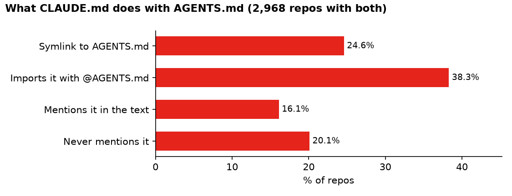

# Agent Files Index: CLAUDE.md, AGENTS.md and SKILL.md files in 38,272 GitHub repos

[](https://github.com/prasadus92/agent-files-index/actions/workflows/test.yml) [](data/LICENSE) [](LICENSE)

A CLAUDE.md file or an AGENTS.md file is a Markdown file in a repo that a coding agent reads before it starts work: the commands to run, the conventions to follow and the things to avoid. This repo has 2 things:

- **An open dataset** of what those files contain in every public GitHub repo with 1,000+ stars, plus a sample of smaller repos. CSV and Parquet in [`data/`](data/), licensed [CC BY 4.0](data/LICENSE), with a [data card](data/README.md).
- **`agentfiles`**, a checker that lints your own `AGENTS.md`, `CLAUDE.md` and `SKILL.md` files against rules drawn from the data and from the published guidance. Python 3.11+, no dependencies, MIT.

Method: [`docs/method.md`](docs/method.md). Write-up with charts: [prasad.tech/blog/agent-files-index](https://prasad.tech/blog/agent-files-index/).

## Findings, snapshot 15 November 2026

The census covers 38,272 public repos with 1,000 or more stars and a push in the last 12 months. Shares below are for the census unless they say otherwise.

- **Adoption.** 21.3% have an `AGENTS.md` or `CLAUDE.md` (at the root or in `.claude/`): 17.3% have `AGENTS.md`, 12.0% `CLAUDE.md`, 8.0% both. In a 5% sample of repos with 100 to 999 stars it is 15.2%.
- **Stars and age.** The share rises from 17.8% at 1,000 to 1,999 stars to 47.5% at 50,000 or more. 38.9% of repos created in 2026 have one, against 15% to 17% for repos created in 2013 to 2020.
- **Length.** The median `AGENTS.md` is 96 lines and the median `CLAUDE.md` is 55. 16.5% of `CLAUDE.md` files are over the 200 lines Claude Code's docs suggest, and 4.0% of `AGENTS.md` files are over the 32 KiB Codex reads.
- **Commands.** 57.4% of `AGENTS.md` files and 40.1% of `CLAUDE.md` files give the agent a test command.
- **Both files.** In the 2,968 repos with a root `AGENTS.md` and `CLAUDE.md`, `CLAUDE.md` imports `AGENTS.md` in 38.3%, is a symlink to it in 24.6%, mentions it in 16.1%, and never refers to it in 20.1%. Claude Code reads `AGENTS.md` only when there is no `CLAUDE.md`, so in that last group Claude never sees it.
- **Stale paths.** 27.1% of `AGENTS.md` and 28.6% of `CLAUDE.md` files that name repo paths name at least 1 that is nowhere in the repo. A hand check of 30 such paths found 11 stale. The other 19 were build output, placeholders, files in other repos, or files the agent is told to create.
- **Maintenance.** 20.0% of `AGENTS.md` and 34.0% of `CLAUDE.md` files have a single commit.
- **Skills.** 29,352 `SKILL.md` files in 4,130 repos across both strata. 98.9% have frontmatter, and 3.5% have a `name` that breaks the spec or does not match its folder.
- **Secrets.** The raw patterns matched 119 file and pattern pairs. After removing placeholders, local dev credentials and low-entropy values, 2 files remain. Each has an AWS-format access key ID with no secret key beside it.




Every number is in [`data/summary.json`](data/summary.json).

## Run the checker

```bash
uvx --from git+https://github.com/prasadus92/agent-files-index agentfiles lint
```

Or install it:

```bash
pip install git+https://github.com/prasadus92/agent-files-index
```

With no path it lints the current folder: `AGENTS.md` and `CLAUDE.md` at any depth, and `SKILL.md` files. Example output:

```text
CLAUDE.md: warning AF601 CLAUDE.md never mentions AGENTS.md: AGENTS.md sits next to this file and is never mentioned; add @AGENTS.md or symlink CLAUDE.md to it
CLAUDE.md:41: warning AF401 referenced path does not exist: `src/server/routes.ts` not found
.claude/skills/pdf/SKILL.md: error AF502 invalid skill name: name 'PDF Tools' must be 1 to 64 lowercase letters, digits or single hyphens
```

Options: `--format json`, `--min-severity warning`, and `--strict` to exit 1 on warnings. `agentfiles rules` lists every rule with its source. Exit code 1 means an error was found; 2 means a file could not be read.

### In CI

```yaml
- uses: prasadus92/agent-files-index@v0.1.0
  with:
    min-severity: warning
```

### As a pre-commit hook

```yaml
- repo: https://github.com/prasadus92/agent-files-index
  rev: v0.1.0
  hooks:
    - id: agentfiles
```

## Rules

| Rule | Severity | Checks | Source |
| --- | --- | --- | --- |
| AF101 | error | Secret-like strings (cloud and API keys, private keys, remote connection strings with passwords) | GitHub's analysis of 2,500 agents.md files |
| AF102 | warning | Absolute home-directory paths such as `/Users/<name>/` | Index data |
| AF103 | warning | Unquoted text telling the agent to ignore its instructions or keep something from the user | Index data |
| AF104 | info | `curl` or `wget` piped into a shell | Index data |
| AF201 | warning | `CLAUDE.md` longer than 200 lines | Claude Code memory docs |
| AF202 | error | `AGENTS.md` larger than 32 KiB, where Codex stops reading | Codex AGENTS.md docs |
| AF203 | warning | `SKILL.md` body longer than 500 lines | Agent Skills specification |
| AF204 | warning | Empty file | Codex AGENTS.md docs |
| AF301 | warning | No test command | agents.md, Claude Code best practices |
| AF302 | info | No build, lint or typecheck command | Claude Code best practices |
| AF303 | warning | Project installs with more than 1 JS package manager | Index data |
| AF304 | warning | Over 30 lines with no headings | Claude Code memory docs |
| AF305 | info | Vague instructions such as "follow best practices" | Claude Code memory docs |
| AF306 | info | More than 10 uses of IMPORTANT, MUST, NEVER and similar | Claude Code best practices |
| AF401 | warning | A referenced path that exists nowhere in the repo | Index data |
| AF402 | error | An `@path` import in `CLAUDE.md` whose file is missing | Claude Code memory docs |
| AF403 | info | `@path` import lines in `AGENTS.md`, which other tools read as plain text | agents.md |
| AF501 | error | `SKILL.md` without YAML frontmatter | Agent Skills specification |
| AF502 | error | Skill `name` that is not 1 to 64 lowercase letters, digits and single hyphens, or does not match its folder | Agent Skills specification |
| AF503 | error | Skill `description` missing or over 1,024 characters | Agent Skills specification |
| AF504 | warning | Skill `description` written as "I can" or "You can" | Anthropic skill authoring guide |
| AF505 | warning | `anthropic` or `claude` in a skill name | Anthropic skill authoring guide |
| AF601 | warning | `CLAUDE.md` next to an `AGENTS.md` it never mentions | Claude Code memory docs |
| AF602 | info | `CLAUDE.md` at least 90% the same as `AGENTS.md` | Index data |

Each rule has a test that fires it and a test that does not, and `python -m tests.ablate` checks that removing any rule makes a test fail.

## The dataset

| Table | One row per |
| --- | --- |
| `repos` | Repo in the frame, with a flag for each agent file location |
| `files` | Agent file, with about 80 structural features and lint counts |
| `headings` | Heading, normalized, with its section categories; the text is kept only for headings shared by 5 or more repos |
| `commands` | Command a file tells the agent to run: the tool name and its kind |
| `lint_findings` | Rule a file triggers (the secret and injection rules are excluded) |
| `secret_like_summary` | Pattern, stratum and file kind, counts only |
| `risky_text_summary` | Signal, stratum and file kind, counts only |

The tables hold derived features. File text is never published. Each file row carries the repo, commit SHA and blob SHA, so you can open the original on GitHub under its own license.

### Rebuild it

```bash
uv sync --group data
python -m pipeline.enumerate RAW_DIR
python -m pipeline.fetch RAW_DIR
python -m pipeline.check_paths RAW_DIR
python -m pipeline.resolve_paths RAW_DIR
python -m pipeline.export RAW_DIR data
python -m pipeline.analyze data RAW_DIR
python -m pipeline.charts data charts
```

`RAW_DIR` holds full file text, so keep it outside the repo and never publish it. A full run takes about 2.5 hours and fits within the hourly API limits of 1 GitHub token.

## Cite

See [`CITATION.cff`](CITATION.cff), or:

```bibtex
@misc{subrahmanya2026agentfiles,
  author = {Subrahmanya, Prasad},
  title  = {Agent Files Index: features of public AGENTS.md, CLAUDE.md and SKILL.md files},
  year   = {2026},
  note   = {Snapshot 2026-11-15},
  url    = {https://github.com/prasadus92/agent-files-index}
}
```

## License

Copyright Prasad Subrahmanya (https://prasad.tech).

Code: MIT ([`LICENSE`](LICENSE)). Data in `data/`: CC BY 4.0 ([`data/LICENSE`](data/LICENSE)). The source files belong to their repos and keep their own licenses; this dataset does not redistribute them.
